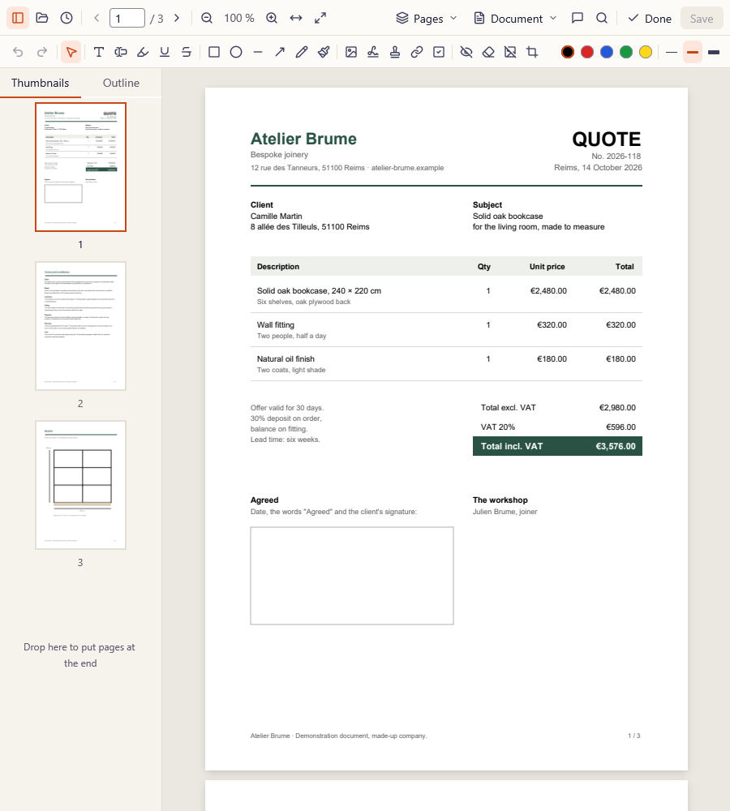
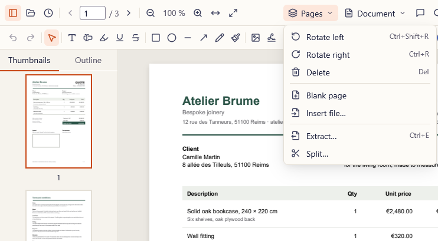
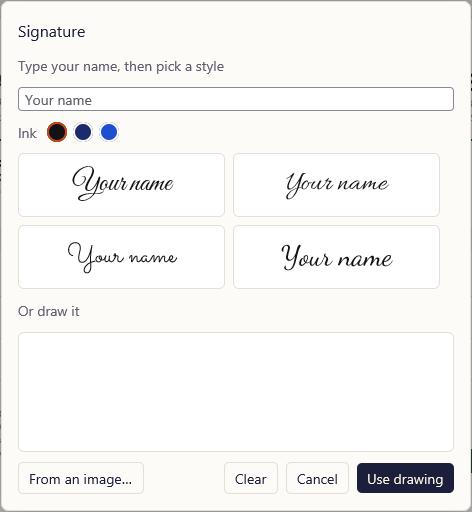
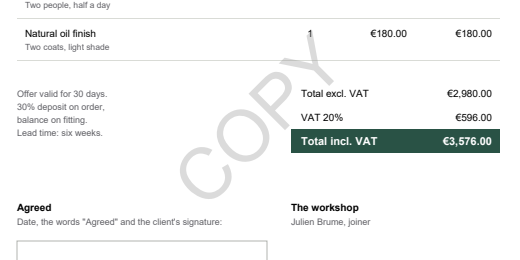
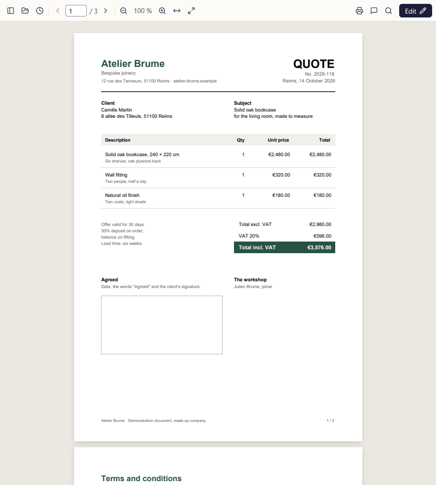
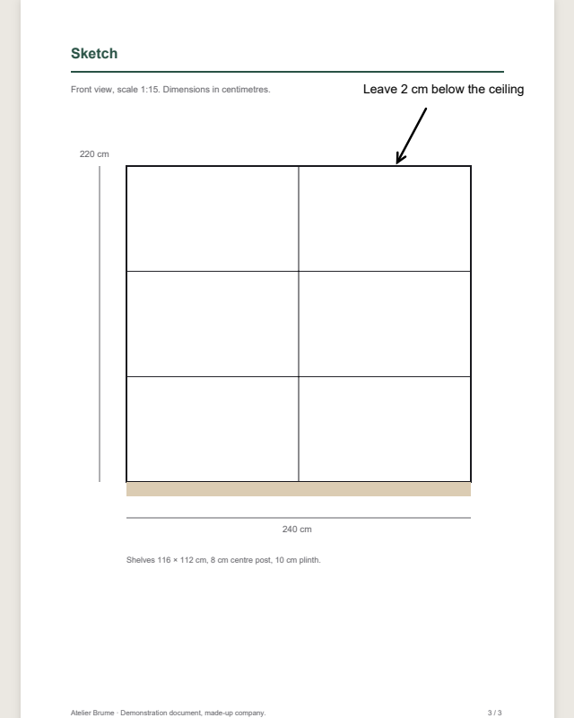
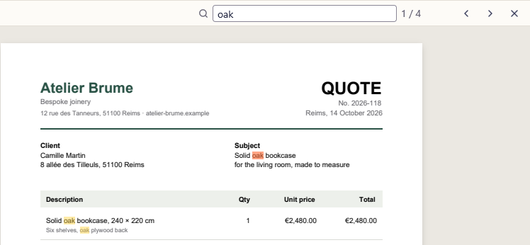
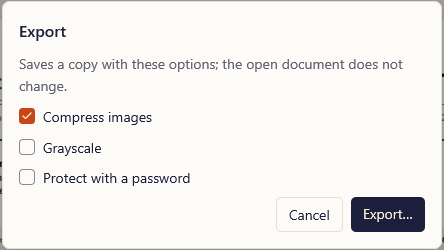

<p align="center">
  <picture>
    <source media="(prefers-color-scheme: dark)" srcset="assets/brand/recto-horizontal-reversed.svg">
    
  </picture>
</p>

<p align="center"><strong>Every PDF job, on your computer.</strong><br>
Read, organize, annotate, sign, fill and edit PDFs without uploading them anywhere. Free, no account, no daily limit.</p>

<p align="center">
  <a href="https://github.com/EvanPluchart/recto/releases/latest"></a>
  <a href="https://github.com/EvanPluchart/recto/releases"></a>
  
  <a href="LICENSE"></a>
</p>

<p align="center">
  <a href="https://github.com/EvanPluchart/recto/releases/latest"><strong>Download</strong></a> ·
  <a href="https://evanpluchart.github.io/recto/en/">Website</a> ·
  <a href="https://evanpluchart.github.io/recto/">Site en français</a> ·
  <a href="docs/ARCHITECTURE.md">How it works</a>
</p>

<p align="center">
  
</p>

**Contents:** [Features](#features) · [Why offline](#why-offline) · [Install](#install) · [Privacy](#privacy-and-security) · [Build from source](#build-from-source) · [Credits](#credits)

---

Most people reach for a website when they need to merge two PDFs, sign a contract or fill a form, and hand their documents to a stranger's server along the way. Recto does those jobs on your machine, in a native app that opens instantly.

## Features

**Read**

* Smooth continuous scrolling, zoom, fit to width or page, thumbnails and the document's outline.
* Search, select and copy text, follow links, print.
* Opens password-protected files.

**Organize pages**

* Rotate, delete, reorder by drag and drop, insert blank pages or another file.
* Merge, split (by ranges, every N pages, or by bookmark), extract, crop.
* Undo and redo everything until you save.

**Annotate, sign and fill**

* Text, highlights, underline and strikeout, shapes, arrows, freehand, images, stamps, links.
* **Signatures** drawn, typed in a handwriting font, or from an image, kept for your next documents.
* **Fill in forms**, then flatten them so nobody can change the answers.

**Document tools**

* **Redact** for real: the text and images underneath are removed, not just covered.
* Watermark, page numbers, headers and footers, document properties.
* **Compress**, convert to grayscale, protect with a password.
* **OCR**: make a scanned document searchable and selectable, offline.
* **Edit existing text** in place (beta).

**And also**

* **Updates itself** in one click, and reopens your document afterwards.
* "Open with Recto" for PDF files, without taking over your default viewer.
* English and French.

<table>
  <tr>
    <td width="33%"></td>
    <td width="33%"></td>
    <td width="33%"></td>
  </tr>
  <tr>
    <td align="center"><sub>Organize pages</sub></td>
    <td align="center"><sub>Sign</sub></td>
    <td align="center"><sub>Watermark</sub></td>
  </tr>
</table>

<details>
<summary><strong>More screenshots</strong></summary>
<br>

| | |
|---|---|
|  |  |
| <p align="center"><sub>Reading</sub></p> | <p align="center"><sub>Freehand</sub></p> |
|  |  |
| <p align="center"><sub>Search</sub></p> | <p align="center"><sub>Export: compress, grayscale, protect</sub></p> |

</details>

## Why offline

| | Typical online PDF tools | Recto |
|---|:---:|:---:|
| Your files are uploaded to a server | yes | **no** |
| Daily limit or watermark on the free plan | often | **no** |
| Account required for some tools | often | **no** |
| Works without an internet connection | no | **yes** |
| File size | capped | **no limit** |
| Price | subscription for the full set | **free, open source** |

## Install

Download the latest version from the [releases page](https://github.com/EvanPluchart/recto/releases/latest):

* **`Recto-x.y.z-windows-x64-setup.exe`** installs Recto for your account, without administrator rights (or for everyone, if you choose). It adds Recto to "Open with" for PDF files; to make it your default viewer, pick it in Settings › Default apps.
* **`Recto-x.y.z-windows-x64.zip`** is a portable folder to run from anywhere.

Then Recto keeps itself up to date: when a new version is out, **Update to x.y.z** appears in its bar. One click downloads and checks it, asks about unsaved changes as closing does, installs it and reopens your document.

<details>
<summary><strong>Windows warns that the file is unknown</strong></summary>
<br>

The executables are not code-signed yet, so SmartScreen may warn on first launch: choose **More info**, then **Run anyway**. Each release publishes `SHA256SUMS`, so you can check that what you downloaded is what was built:

```powershell
Get-FileHash .\Recto-0.1.2-windows-x64-setup.exe -Algorithm SHA256
```

</details>

<details>
<summary><strong>Updates in detail</strong></summary>
<br>

* Recto asks GitHub which version is the newest a few seconds after it opens, then every 6 hours. Turn that off with `--no-update-check` or the `RECTO_NO_UPDATE_CHECK` environment variable.
* The download is checked against the release's `SHA256SUMS` before it runs.
* Recto never closes a window with unsaved work: with another Recto window open, it asks you to close it first.
* Installs made for every account, and the portable zip, open the download page instead of updating in place.

Details in [decision 0006](docs/decisions/0006-updates-from-the-app.md).

</details>

<details>
<summary><strong>macOS and Linux</strong></summary>
<br>

Recto is built for Windows first. Some releases include preview packages for macOS on Apple Silicon (`.dmg`) and Linux (AppImage), which have not been tried by hand yet. Reports are welcome.

On macOS, open the `.dmg` and drag Recto into Applications. The app is not notarised by Apple, so the first launch is blocked: open **System Settings › Privacy & Security** and click **Open Anyway**, once.

</details>

## Privacy and security

* **Your documents never leave your computer.** Every feature, OCR included, runs locally.
* **No account, no telemetry.** Recto's only network request asks GitHub whether a new version is out. Links in a document open in your browser only when you click them.
* **Saving is safe.** Recto writes a new file next to the old one and swaps them, so a crash or a full disk never leaves you with half a document.
* **Redaction removes content**: the text, images and drawings under a redaction are deleted from the file, not hidden behind a black box.
* **No administrator rights** needed, unless you choose to install for every account.

## Build from source

You need Rust (stable) on Windows; [Inno Setup 6](https://jrsoftware.org/isinfo.php) only to build the installer.

```sh
cargo xtask fetch-pdfium         # the pinned PDFium build, into target/pdfium/
cargo xtask fetch-ocr-models     # the OCR models, into target/ocr-models/
cargo run -p recto -- tests/fixtures/sample.pdf --page=1 --zoom=100
cargo test --workspace
cargo clippy --workspace -- -D warnings
cargo xtask dist                 # installer and portable zip in target/dist/
```

`cargo xtask gen-large` writes a 500-page file for scrolling and search checks, and `cargo xtask gen-fixtures` regenerates the test fixtures. On Linux, GPUI needs the X11/Wayland, xkbcommon, Vulkan and fontconfig development packages.

How it is built is in [docs/ARCHITECTURE.md](docs/ARCHITECTURE.md); settled design choices are in [docs/decisions](docs/decisions), coverage in the [feature matrix](docs/FEATURES.md), and what comes next in the [roadmap](docs/ROADMAP.md).

<details>
<summary><strong>Built with</strong></summary>
<br>

* [GPUI](https://crates.io/crates/gpui), the GPU-rendered interface framework of the Zed editor.
* [PDFium](https://pdfium.googlesource.com/pdfium/) through [`pdfium-render`](https://crates.io/crates/pdfium-render), for rendering pages and forms.
* [`lopdf`](https://crates.io/crates/lopdf) and [`pdf-writer`](https://crates.io/crates/pdf-writer), for changing documents in pure Rust.
* [`ocrs`](https://crates.io/crates/ocrs), for text recognition.

</details>

## Credits

* Icons from [Lucide](https://lucide.dev) (ISC).
* Signature fonts Great Vibes, Allura, Sacramento and Dancing Script (SIL Open Font License). Full notices in [`crates/recto-app/assets/NOTICE.md`](crates/recto-app/assets/NOTICE.md).
* Text recognition models by Robert Knight's [ocrs](https://huggingface.co/robertknight/ocrs) project (CC BY-SA 4.0), shipped unchanged as separate files ([notice](packaging/notices/OCR-MODELS.txt)).

## License

[MIT](LICENSE).
